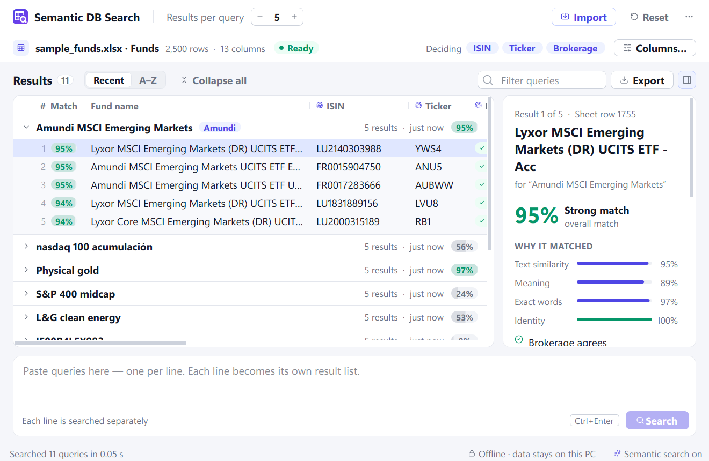

# Semantic DB Search

An installable Windows desktop app that finds the rows of your spreadsheet database that
best match each line you paste — intelligently. It understands meaning (abbreviations,
typos, Spanish ↔ English), stays exact where it matters (`S&P 500` is not `S&P 400`, an ISIN
is an ISIN), and never mixes up the identities you mark as **deciding**: a query for an
*iShares* fund will not return a *Vanguard* fund first just because more of the other words
happen to overlap.

**Everything runs locally.** It is a native program, not a website: no web server, no browser,
no open network port, no internet connection. Your database, queries and results never leave
your computer.



## Features

- **Import** Excel (`.xlsx`, `.xlsm`, `.xlsb`, `.xls`), OpenDocument (`.ods`) or CSV/TSV files.
  Pick the sheet and header row; drag and drop works too.
- **Deciding columns.** Tick the columns that define identity (brokerage, issuer, ISIN…).
  Suggestions are made for you, with the reason shown.
- **No alias tables to maintain.** The app learns from your own data that, for example, fund names
  starting with *iShares* belong to the brokerage *BlackRock*, or that *Lyxor* funds belong to
  *Amundi*. Abbreviations such as `ISHS` or `JPM` are recognised too.
- **Paste many queries at once**, one per line (copying a column from Excel works). Each line gets
  its own collapsible list of the most similar rows, best first.
- **Results per query** (1–50) at the top left; **Import** and **Reset** at the top right.
- **Collapse/expand all**, sort the lists by **recency** or **A–Z**, filter them, see *why* each
  row matched, copy rows straight into Excel.
- **Export to Excel**: a *Summary* sheet with each query and its matches side by side, plus a
  *Details* sheet with every column.
- **Results persist** between sessions; **Reset** clears them.
- Light and dark themes (follows Windows by default).

## Install

Download `SemanticDBSearch-Setup-1.0.0.exe` and run it. It installs for your user account only
(no administrator rights needed) and adds a Start-menu entry. Uninstall it from *Settings → Apps*;
the uninstaller asks whether to also delete your saved data.

Requirements: Windows 10 or 11, 64-bit. The installer is 113 MB; the installed app takes about
250 MB (most of it is the bundled language model and Qt).

## How to use it

1. **Import your database.** Click **Import** (or drop a file on the window). In the setup dialog,
   check the sheet and header row, then choose how each column is used:
   - **Deciding** — identity that must match (brokerage, issuer, family, ISIN, ticker).
   - **Search** — text that describes the item (fund name, category).
   - **Display only** — shown in results but not used for matching (TER, AUM, dates…).
2. **Wait for the first indexing** (about 40 seconds for 45,000 rows; afterwards the app starts in
   seconds because it remembers what it has already processed).
3. **Paste your queries** in the box at the bottom, one per line, and press **Search**
   (Ctrl+Enter).
4. **Open a list** to see the matches. Select a match to see all its fields and why it ranked
   there. Ctrl+C copies selected rows as Excel-ready text; **Export** saves everything to `.xlsx`.

Want to try it first? Choose **Try with sample data** on the start screen: a synthetic universe
of 2,500 European funds and ETFs.

## How the matching works

Every query is scored against every row in three complementary ways:

| Signal | What it catches | How |
|--------|-----------------|-----|
| **Identity** (deciding columns) | "this is an iShares fund, so look at BlackRock rows" | Detects deciding values in the query — exact words, learned aliases, abbreviations, typos — and pushes rows from a *different* family far down |
| **Meaning** | abbreviations, synonyms, word order, Spanish ↔ English | Multilingual sentence embeddings (`paraphrase-multilingual-MiniLM-L12-v2`, run offline with ONNX Runtime) |
| **Exact words** | `500` vs `400`, `Acc` vs `Dist`, codes, typos, `Hdg` = `Hedged` | Character n-gram + word TF-IDF index, plus common fund-name abbreviations (English and Spanish) |

Before comparing text, identity fragments are removed from both sides (the brand inside a fund
name, the brand in the query), so the descriptive similarity is not distorted by repeated or
abbreviated identity information. The final score is

```
score = text similarity (meaning + exact words) × identity agreement
```

so an otherwise similar fund from the wrong brokerage drops to the bottom, while rows without
any identity conflict compete on their description. An ISIN or ticker in the query is an exact hit.

Measured on a synthetic 45,000-row fund universe with 600 perturbed queries — abbreviated
brands, the company instead of the brand, typos, reordered or missing words, reworded share
classes, Spanish/English paraphrases, bare ISINs (`python tools/evaluate.py`; weights were tuned on
a *different* random universe, so this is a held-out test):

| Configuration | Top-1 | Top-5 | MRR@10 | Wrong brand in top 5 |
|---|---:|---:|---:|---:|
| **Full app** (identity + meaning + exact words) | 0.933 | **0.982** | 0.957 | **0.3 %** |
| Without the identity layer | 0.912 | 0.963 | 0.936 | 2.9 % |
| Without meaning (exact words only) | **0.940** | 0.980 | **0.958** | 0.4 % |
| Meaning-heavy blend | 0.848 | 0.932 | 0.885 | 0.6 % |

The identity layer is what keeps brands apart (wrong-brand results drop tenfold). Meaning and
exact words tie overall on this synthetic set but fail differently: embeddings win on paraphrases
(English paraphrase top-1 0.81 vs 0.74) and exact names, the word index wins on typos (0.95 vs
0.88), so the app blends them with a light semantic weight. A search takes about 16 ms over
45,000 rows (95th percentile 27 ms); indexing 45,000 rows the first time takes about 40 seconds,
and a few seconds afterwards.

## Privacy and security

- Native Qt window. The app opens no sockets and contains no networking code; the embedding
  model ships inside the installer.
- Imported files are parsed by [calamine](https://github.com/tafia/calamine) (memory-safe Rust)
  in a separate, memory-capped helper process: macros and formulas are never executed, and a
  malicious or broken spreadsheet cannot crash the app or exhaust your computer's memory.
- Exports never turn text into Excel formulas (protection against formula injection).
- Your data lives in `%LOCALAPPDATA%\SemanticDBSearch` (open it from the **⋯** menu).

## Building from source

Requires Windows, Python 3.13 and (for the installer) [Inno Setup 6](https://jrsoftware.org/isinfo.php).

```powershell
py -3.13 -m venv .venv
.venv\Scripts\python -m pip install -r requirements-dev.txt
.venv\Scripts\python -m pip install -e . --no-deps
.venv\Scripts\python tools\fetch_model.py      # download, verify, quantize the model (once, ~1 min)
.venv\Scripts\python -m semdb                  # run from source
.venv\Scripts\python -m semdb --selftest       # headless end-to-end check
.\packaging\build.ps1                          # tests → PyInstaller → self-test → installer in dist\
```

The model download is the only step that uses the internet; it is pinned to an exact upstream
revision and verified by SHA-256 before quantization.

| Path | Purpose |
|------|---------|
| `src/semdb/core/` | import, column profiling, identity model, lexical index, embeddings, ranking, export |
| `src/semdb/storage.py` | SQLite persistence (database snapshot, history, settings, embedding cache) |
| `src/semdb/ui/` | the Qt interface |
| `tools/` | model download, sample data, evaluation, icon and screenshot generators |
| `packaging/` | PyInstaller spec, Inno Setup script, build script |
| `docs/ARCHITECTURE.md` | full design and specification |

Run the tests with `.venv\Scripts\python -m pytest`.

## License

MIT — see [LICENSE](LICENSE). Bundled third-party components are listed in
[THIRD_PARTY_NOTICES.md](THIRD_PARTY_NOTICES.md).
